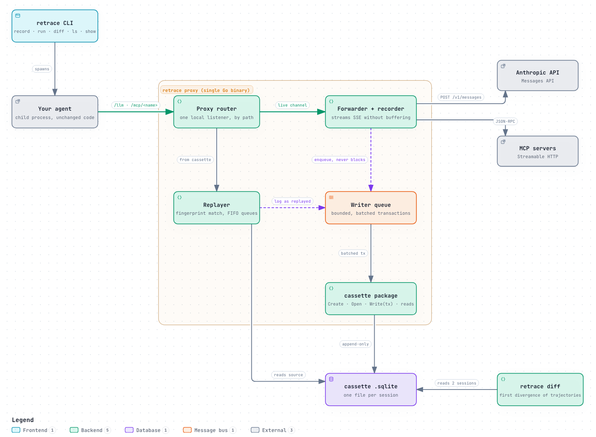

# retrace

[](https://github.com/pmlucero/retrace/actions/workflows/docs.yml)
[](LICENSE)
[](#project-status)

**Record, replay and diff AI agent sessions. Swap the model, freeze the tools, see exactly where behavior diverges.**

> **Status: MVP in progress.** The design (phase 0) is approved. Built from source, retrace can already record sessions of agents that talk to the LLM and to MCP servers, replay them in all three modes, and inspect and diff them. There is no release yet. See [Project status](#project-status).

## What is retrace

retrace is a VCR for AI agents. It is a transparent proxy, shipped as a single Go binary, that sits between your agent and:

- the **LLM API** (Anthropic Messages API, including streaming), and
- your **MCP servers** (Streamable HTTP).

It records every session into a **cassette**. You can then replay that session deterministically while changing exactly one variable:

- Keep the tools frozen and **swap the model** to see what a different model would have done with the exact same tool results.
- Keep the model's decisions and run the **live tools** to detect when a tool's behavior has drifted.
- **Diff** two sessions to find the first step where they diverge: the step, the tool and the arguments.

Enabling it requires no SDK and no code changes. You point the agent's base URLs at retrace.

## How it works

<picture>
  <source media="(prefers-color-scheme: dark)" srcset="docs/architecture/overview-dark.png">
  
</picture>

- **Record:** the proxy forwards each request upstream, streams the response back unbuffered, and enqueues it for the cassette without ever blocking the agent.
- **Replay:** the router answers a channel from the source cassette by request fingerprint, or forwards it live, depending on the mode. Every replay writes a new cassette.
- **Diff:** compares the trajectories of two cassettes and reports the first divergence.

The diagram source and how to regenerate it are in [docs/architecture](docs/architecture/README.md).

## What retrace is not

retrace is **not** an observability or tracing tool. Langfuse, LangSmith, Phoenix and OpenTelemetry already do that well. retrace is about **replay and experimentation**, and it is designed to be used alongside your tracing stack, not instead of it. See [docs/vision.md](docs/vision.md#5-positioning-vs-existing-tools).

## Replay modes

| Mode | Model | Tools | Use it to… |
|---|---|---|---|
| `exact` | recorded | recorded | Debug a session offline, for free, with no network. |
| `swap-model` | **real, different model** | recorded | Compare models under identical tool results. |
| `live-tools` | recorded | **real** | Detect tool drift against recorded model decisions. |
| `diff` | — | — | Find the first divergence between two trajectories. |

When a replay hits something that was never recorded, retrace stops by default (`strict`) and reports the exact divergence point. It never invents a response silently.

## CLI at a glance

> Every command below works today, built from source. The authoritative definition is in [the spec](docs/spec/core.md#9-cli).

```sh
# Record a session (the agent reads ANTHROPIC_BASE_URL and RETRACE_MCP_*_URL)
retrace record --session checkout --mcp orders=http://localhost:9001/mcp \
               --mcp email=http://localhost:9002/mcp -- python agent.py

# Replay it offline, exactly
retrace run checkout

# Same tool results, different model
retrace run checkout --model <other-model> --tools frozen

# Same model decisions, real tools
retrace run checkout --tools live --mcp orders=http://localhost:9001/mcp

# Where did the trajectories diverge?
retrace diff checkout checkout.swap-model.1

# What is recorded, and what is in one interaction?
retrace ls
retrace show checkout
retrace show checkout --raw 1
```

> ⚠️ Cassettes store prompts and tool outputs verbatim. Auth headers are always redacted, but review a cassette before sharing it.

## Project status

retrace follows **Spec-Driven Development**: vision, spec and ADRs first, code after approval.

| Phase | Scope | State |
|---|---|---|
| 0 | Vision, core spec, ADRs, repo conventions | Done |
| MVP | Record (LLM + MCP), exact replay, swap-model with `strict`, terminal diff, demo agent with two MCP servers | **In progress** |
| Later | Web UI (sequence view, tool topology, model diff), more divergence strategies, more providers and transports | Planned |

Inside the MVP, milestones M0–M6 are done. Built from source, retrace can record an agent that talks to the LLM and to MCP servers over Streamable HTTP with `retrace record`, and replay that session with `retrace run <id>` in any of the three modes:

- `exact` serves every LLM and MCP answer from the cassette, offline.
- `swap-model` (`--model`) forwards LLM requests with the model rewritten and serves MCP from the cassette.
- `live-tools` (`--tools live`) forwards MCP to the real servers and serves the LLM from the cassette.

A request that was never recorded stops the replay under `strict`. The agent gets `SIGTERM`, then `SIGKILL` after `--grace`, and retrace prints a divergence report with the first miss (and its JSON-path diff, when there is one), then exits `3`.

Sessions can then be inspected and compared from the terminal. The examples below are real output, trimmed, taken from the golden files of the CLI tests, so each one comes from a different set of test sessions. `retrace ls` lists the cassettes, newest first, with their totals (`--json` for the same data unabbreviated):

```text
ID                     CREATED              MODE        PARENT    STATUS          STEPS  TOKENS      COST (est.)  DURATION
checkout.swap-model.1  2026-10-23 11:30:00  swap-model  checkout  diverged        1      999/42      1 unpriced   1m01s
checkout.exact.1       2026-10-23 10:30:00  exact       checkout  completed+gaps  1      20.0k/1.5k  $0.10        2.0s
checkout               2026-10-23 09:30:00  record                completed       2      41.2k/3.9k  $0.18        38.2s
```

`+gaps` marks a session whose event log lost events while it was recorded, so its steps and totals are incomplete. `retrace show <id>` prints a session's summary and its timeline of events, `--json` emits the events as JSONL, and `--raw <interaction-id>` dumps one interaction as stored, after redaction: headers, bodies and SSE chunks with their offsets.

`retrace diff <a> <b>` compares the trajectories of two sessions and reports the first divergence. It exits `0` when they are identical, `1` when they diverge and `2` on an error, like `diff(1)`:

```text
               A: claude-sonnet-4-5    B: claude-haiku-4-5
steps          3                       2  (stopped: cassette miss)
tool calls     2                       2
tokens         3,000 in / 300 out      2,000 in / 200 out
cost (est.)    $0.03                   $0.02
duration       38.2s                   11.9s

✗ first divergence at step 2, event tool_use
    A  search_orders  {"customer_id":"c_812","status":"open"}
    B  search_orders  {"customer_id":"c_812"}
       - $.status: "open" → (missing)

  step 1 identical (1 tool call)
  B stopped at step 2: cassette miss on mcp:shop

text differs in step 1 (not compared; use --text)
```

Model text is not compared unless you pass `--text`. `--format json` prints the same result as JSON, which validates against the committed schema [docs/schema/diff.v1.json](docs/schema/diff.v1.json).

M7 comes next: the demo agent with two MCP servers, and the first release ([#22](https://github.com/pmlucero/retrace/issues/22)). See the [MVP plan](docs/plan/mvp.md).

## Documentation

- [Vision](docs/vision.md): the problem, principles, non-goals and positioning.
- [Core spec](docs/spec/core.md): modes, matching, the cassette data model, diff, CLI and acceptance criteria.
- [Architecture decisions](docs/adr/README.md).
- [MVP plan](docs/plan/mvp.md): milestones and the order of implementation.
- [Architecture diagram](docs/architecture/README.md): the overview above, with its source.

## License

[Apache 2.0](LICENSE)
