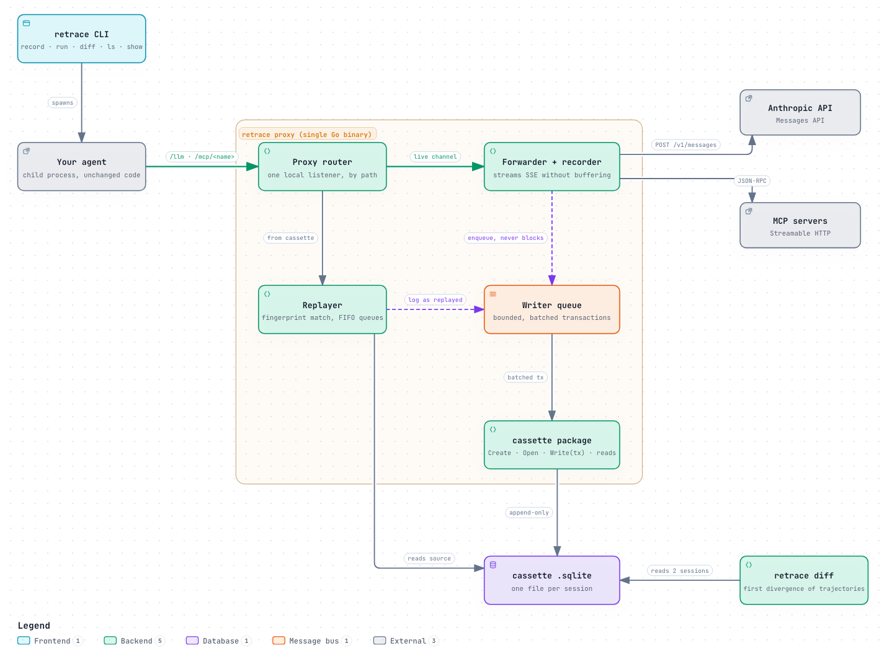

# retrace

[](https://github.com/pmlucero/retrace/actions/workflows/go.yml)
[](https://github.com/pmlucero/retrace/releases)
[](LICENSE)
[](go.mod)
[](#project-status)

**Record, replay and diff AI agent sessions. Swap the model, freeze the tools, see exactly where behavior diverges.**

> **Status: MVP complete.** retrace records sessions of agents that talk to the LLM and to MCP servers, replays them in all three modes, inspects and diffs them, and checks a whole corpus as a CI gate. The latest release is v0.2.0. See [Project status](#project-status).


*Record a real session, replay it exactly (identical), then replay it against a changed shipping server: retrace stops at the first divergence and `diff` shows the tool result that changed.*

<!-- markdownlint-disable MD033 -->
<details>
<summary>Transcript of the demo</summary>

Output is abridged: long log lines and temporary paths are dropped.

Step 1. Record a real agent session, with two MCP servers

```text
$ retrace record --session checkout --mcp orders=http://127.0.0.1:9001/mcp --mcp shipping=http://127.0.0.1:9002/mcp -- uv run --locked python agent.py
Your shipped order o_1002 (one steel kettle) is in transit with Parcelo, tracking number trk_7342. It was last scanned at the central hub on October 21, and the estimated delivery date is October 24, 2026.
level=INFO msg="session recorded" session=checkout status=completed ...
```

Step 2. Replay it exactly: no network, same trajectory

```text
$ retrace run checkout --as checkout.exact --recorded-command
$ retrace diff checkout checkout.exact

✓ trajectories identical (3 steps, 2 tool calls)
```

Step 3. Your shipping API changed: replay with live tools, see where the agent diverges

```text
$ retrace run checkout --as checkout.live --tools live --mcp shipping=http://127.0.0.1:9003/mcp --recorded-command
level=WARN msg="cassette miss" channel=llm upstream=anthropic reason="no recorded request matches this one"
retrace: replay checkout.live diverged from checkout
  first miss: anthropic POST /v1/messages
  misses: 1
  compare: retrace diff checkout checkout.live

$ retrace diff checkout checkout.live

               A: claude-haiku-5-5    B: claude-haiku-5-5
steps          3                      2  (stopped: cassette miss)
tool calls     2                      ...

✗ first divergence at step 2, event tool_result
    A  mcp:shipping track_package  ...  ok
    B  mcp:shipping track_package  ...  ok
       - $.structuredContent.estimated_delivery: "2026-10-24" → "2026-10-29"
       - $.structuredContent.status: "in_transit" → "delayed"

  step 1 identical (1 tool call)
  B stopped at step 2: cassette miss on anthropic
```

</details>
<!-- markdownlint-enable MD033 -->

## What is retrace

retrace is a VCR for AI agents. It is a transparent proxy, shipped as a single Go binary, that sits between your agent and:

- the **LLM API** (Anthropic Messages API, including streaming), and
- your **MCP servers** (Streamable HTTP).

It records every session into a **cassette**. You can then replay that session deterministically while changing exactly one variable:

- Keep the tools frozen and **swap the model** to see what a different model would have done with the exact same tool results.
- Keep the model's decisions and run the **live tools** to detect when a tool's behavior has drifted.
- **Diff** two sessions to find the first step where they diverge: the step, the tool and the arguments.

Enabling it requires no SDK and no code changes. You point the agent's base URLs at retrace.

## How it works

<picture>
  <source media="(prefers-color-scheme: dark)" srcset="docs/architecture/overview-dark.png">
  
</picture>

- **Record:** the proxy forwards each request upstream, streams the response back unbuffered, and enqueues it for the cassette without ever blocking the agent.
- **Replay:** the router answers a channel from the source cassette by request fingerprint, or forwards it live, depending on the mode. Every replay writes a new cassette.
- **Diff:** compares the trajectories of two cassettes and reports the first divergence.

The diagram source and how to regenerate it are in [docs/architecture](docs/architecture/README.md).

## What retrace is not

retrace is **not** an observability or tracing tool. Langfuse, LangSmith, Phoenix and OpenTelemetry already do that well. retrace is about **replay and experimentation**, and it is designed to be used alongside your tracing stack, not instead of it. See [docs/vision.md](docs/vision.md#5-positioning-vs-existing-tools).

## Replay modes

| Mode | Model | Tools | Use it to… |
|---|---|---|---|
| `exact` | recorded | recorded | Debug a session offline, for free, with no network. |
| `swap-model` | **real, different model** | recorded | Compare models under identical tool results. |
| `live-tools` | recorded | **real** | Detect tool drift against recorded model decisions. |
| `diff` | — | — | Find the first divergence between two trajectories. |

When a replay hits something that was never recorded, retrace stops by default (`strict`) and reports the exact divergence point. It never invents a response silently.

## Checking a corpus in CI

`retrace check` replays every recorded session in the cassette directory against one change and answers: did my change alter my agent's behavior? The change is the agent's code, a different model (`--model`) or today's tools (`--tools live`). Each replay ends as `identical`, `diverged`, `error` or `skipped`, and the exit code can gate a pull request:

| Exit | Meaning | Precedence |
|---|---|---|
| `3` | at least one replay `diverged` | first: a finding stands whatever else failed |
| `1` | no divergence, but an `error` or a failed check (empty corpus, unwritable `--out` or `--markdown`, interruption) | second |
| `5` | no divergence or error, but the budget `skipped` a replay (not a pass) | third |
| `0` | every replay `identical` | |
| `2` | usage error | |

A minimal GitHub Actions job, with the corpus committed in `cassettes/`:

```yaml
jobs:
  retrace:
    runs-on: ubuntu-latest
    steps:
      - uses: actions/checkout@v4
      - name: Install retrace
        env:
          GH_TOKEN: ${{ github.token }}
        run: |
          gh release download --repo pmlucero/retrace --pattern 'retrace_*_linux_amd64.tar.gz'
          gh attestation verify retrace_*_linux_amd64.tar.gz --repo pmlucero/retrace
          tar -xzf retrace_*_linux_amd64.tar.gz retrace
          echo "$PWD" >> "$GITHUB_PATH"
      - name: Check the corpus
        run: retrace --dir cassettes check --recorded-command --cwd . --markdown "$GITHUB_STEP_SUMMARY"
```

- `check` needs retrace v0.2.0 or later.
- `--format json` prints one JSON document that validates against [docs/schema/check.v1.json](docs/schema/check.v1.json).
- `--cwd .` reruns each recorded argv inside the checkout under test, so record with relative paths and commands on `PATH`. An argv with an absolute path still needs that path on the runner.
- `swap-model` calls the real API: pass `ANTHROPIC_API_KEY` as a secret and set `--max-cost`. `--repeat <n>` replays each session `n` times. The cost is an estimate from retrace's price table, and `--max-cost` limits what starts, not what the API bills.
- `live-tools` needs the MCP servers started in an earlier step, reached with `--mcp name=url`.
- `--timeout` is the longest one replay may run (default `10m`).

> ⚠️ **A corpus is code.** `check --recorded-command` runs the command of every cassette in the corpus, so a pull request that adds or edits a cassette chooses what runs. Do not run it on untrusted pull requests (for example from forks, or under `pull_request_target`), and never with secrets available to them.

## Install

Download the archive for your platform from the [releases page](https://github.com/pmlucero/retrace/releases) (`retrace check` needs v0.2.0 or later). Each release has a `retrace_<version>_<os>_<arch>.tar.gz` archive (`.zip` on Windows) for Linux, macOS and Windows on amd64 and arm64, and a `checksums.txt` file. Unpack it and put the `retrace` binary on your `PATH`.

Before you run it, check that the archive was built by this repository's release workflow. With the [GitHub CLI](https://cli.github.com/):

```sh
gh attestation verify <archive> --repo pmlucero/retrace
```

Without it, check the archive's SHA-256 sum against `checksums.txt`, downloaded from the same release:

```sh
sha256sum --check --ignore-missing checksums.txt        # Linux
shasum -a 256 --check --ignore-missing checksums.txt    # macOS
```

On Windows, compare `(Get-FileHash <archive>).Hash` in PowerShell with the archive's line in `checksums.txt` (the case can differ). A matching sum shows the download is intact; only the attestation shows who built it. See [ADR 0012](docs/adr/0012-release-integrity.md).

## CLI at a glance

> Every command below works today, built from source. The authoritative definition is in [the spec](docs/spec/core.md#9-cli).

```sh
# Record a session (the agent reads ANTHROPIC_BASE_URL and RETRACE_MCP_*_URL)
retrace record --session checkout --mcp orders=http://localhost:9001/mcp \
               --mcp email=http://localhost:9002/mcp -- python agent.py

# Replay it offline, exactly. run never starts the recorded command unless
# asked (it may be someone else's): give the agent after '--', or use
# --recorded-command for the one the session recorded
retrace run checkout --recorded-command

# Same tool results, different model
retrace run checkout --model <other-model> --tools frozen -- python agent.py

# Same model decisions, real tools
retrace run checkout --tools live --mcp orders=http://localhost:9001/mcp -- python agent.py

# Where did the trajectories diverge?
retrace diff checkout checkout.swap-model.1

# Does a change alter the behavior of every recorded session? (see below)
retrace check --recorded-command --cwd .
retrace check --model <other-model> --repeat 3 --max-cost 2 -- python agent.py

# What is recorded, and what is in one interaction?
retrace ls
retrace show checkout
retrace show checkout --raw 1
```

> ⚠️ Cassettes store prompts and tool outputs verbatim. Auth headers are always redacted, but review a cassette before sharing it. Bodies are stored unredacted unless you pass `--redact <jsonpath>`; `record` warns when you do not.

## Project status

retrace follows **Spec-Driven Development**: vision, spec and ADRs first, code after approval.

| Phase | Scope | State |
|---|---|---|
| 0 | Vision, core spec, ADRs, repo conventions | Done |
| MVP | Record (LLM + MCP), exact replay, swap-model with `strict`, terminal diff, demo agent with two MCP servers | **Done** (first release: v0.1.0) |
| v0.2 | `retrace check`: replay a whole corpus against one change, as a CI gate | **Done** (v0.2.0) |
| Later | Web UI (sequence view, tool topology, model diff), more divergence strategies, more providers and transports | Planned |

The MVP milestones (M0–M7) are done (v0.1.0), and v0.2.0 adds `retrace check`. retrace can record an agent that talks to the LLM and to MCP servers over Streamable HTTP with `retrace record`, and replay that session with `retrace run <id>` in any of the three modes:

- `exact` serves every LLM and MCP answer from the cassette, offline.
- `swap-model` (`--model`) forwards LLM requests with the model rewritten and serves MCP from the cassette.
- `live-tools` (`--tools live`) forwards MCP to the real servers and serves the LLM from the cassette.

A request that was never recorded stops the replay under `strict`. The agent gets `SIGTERM`, then `SIGKILL` after `--grace`, and retrace prints a divergence report with the first miss (and its JSON-path diff, when there is one), then exits `3`.

Sessions can then be inspected and compared from the terminal. The examples below are real output, trimmed, taken from the golden files of the CLI tests. The two examples come from different test fixtures, so their numbers do not match even where the session ids do. `retrace ls` lists the cassettes, newest first, with their totals (`--json` for the same data unabbreviated):

```text
ID                     CREATED              MODE        PARENT    STATUS          STEPS  TOKENS      COST (est.)  DURATION
checkout.swap-model.1  2026-10-23 11:30:00  swap-model  checkout  diverged        1      999/42      1 unpriced   1m01s
checkout.exact.1       2026-10-23 10:30:00  exact       checkout  completed+gaps  1      20.0k/1.5k  $0.10        2.0s
checkout               2026-10-23 09:30:00  record                completed       2      41.2k/3.9k  $0.18        38.2s
```

`+gaps` marks a session whose event log lost events while it was recorded, so its steps and totals are incomplete. `retrace show <id>` prints a session's summary and its timeline of events, `--json` emits the events as JSONL, and `--raw <interaction-id>` dumps one interaction as stored, after redaction: headers, bodies and SSE chunks with their offsets.

`retrace diff <a> <b>` compares the trajectories of two sessions and reports the first divergence. It exits `0` when they are identical, `1` when they diverge and `2` on an error, like `diff(1)`:

```text
               A: claude-sonnet-4-5    B: claude-haiku-4-5
steps          3                       2  (stopped: cassette miss)
tool calls     2                       2
tokens         3,000 in / 300 out      2,000 in / 200 out
cost (est.)    $0.03                   $0.02
duration       38.2s                   11.9s

✗ first divergence at step 2, event tool_use
    A  search_orders  {"customer_id":"c_812","status":"open"}
    B  search_orders  {"customer_id":"c_812"}
       - $.status: "open" → (missing)

  step 1 identical (1 tool call)
  B stopped at step 2: cassette miss on mcp:shop

text differs in step 1 (not compared; use --text)
```

Model text is not compared unless you pass `--text`. `--format json` prints the same result as JSON, which validates against the committed schema [docs/schema/diff.v1.json](docs/schema/diff.v1.json).

### Known limitations

The proxy answers `403` to a request whose `Host` does not name its listen address, and to one that carries an `Origin` or `Sec-Fetch-Site` header, so a web page cannot reach it through DNS rebinding or a cross-origin request (spec §3.6). That has two consequences:

- An agent that runs in a browser or in a desktop application's web view cannot be recorded or replayed, because it sends those headers. The same holds for any runtime that does.
- `host.docker.internal` is rejected. An agent in a container uses the IP address that name resolves to instead (IP literals are accepted; no `--listen-unsafe` is needed for a loopback-bound proxy that Docker Desktop forwards to).

The first release, v0.1.0, ships the MVP ([#22](https://github.com/pmlucero/retrace/issues/22)). See the [MVP plan](docs/plan/mvp.md). v0.2.0 adds `retrace check` ([#181](https://github.com/pmlucero/retrace/issues/181)).

## Documentation

- [Vision](docs/vision.md): the problem, principles, non-goals and positioning.
- [Core spec](docs/spec/core.md): modes, matching, the cassette data model, diff, CLI and acceptance criteria.
- [Spec §9.9, `retrace check`](docs/spec/core.md#99-retrace-check) and [ADR 0015](docs/adr/0015-corpus-check-command.md), with the [JSON schema](docs/schema/check.v1.json).
- [Architecture decisions](docs/adr/README.md).
- [MVP plan](docs/plan/mvp.md): milestones and the order of implementation.
- [Architecture diagram](docs/architecture/README.md): the overview above, with its source.

## License

[Apache 2.0](LICENSE)
